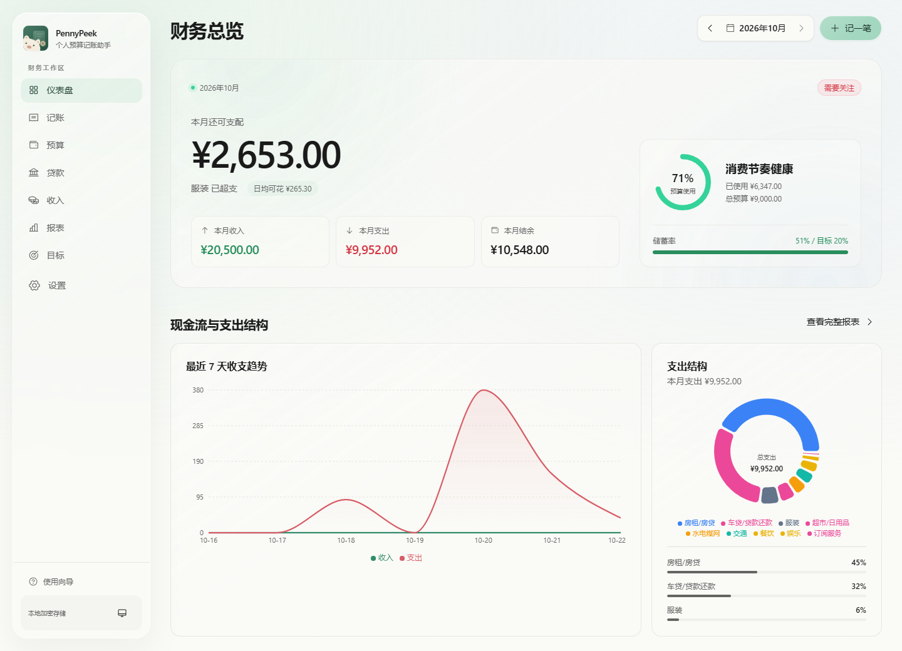
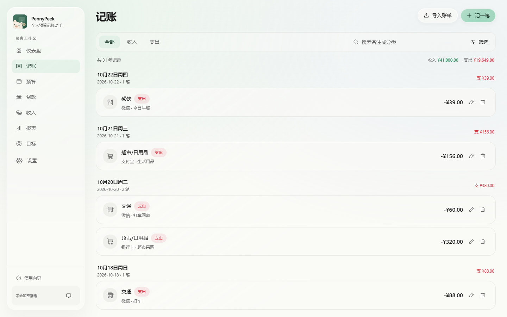
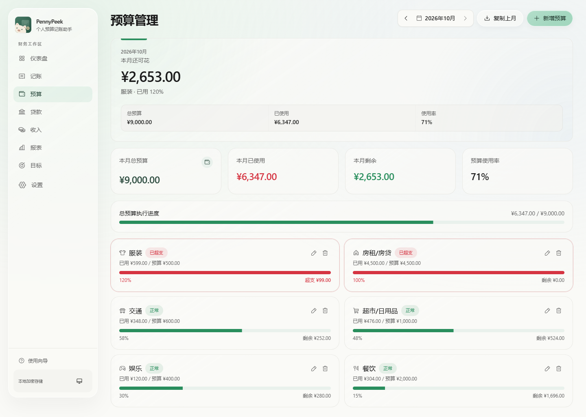
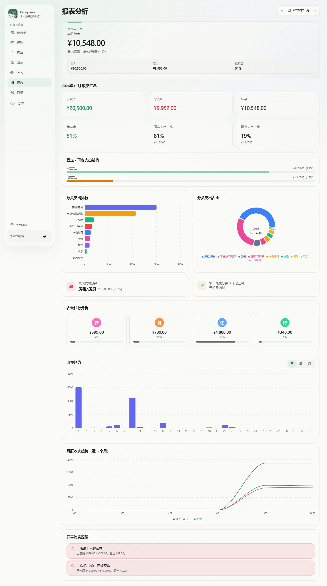
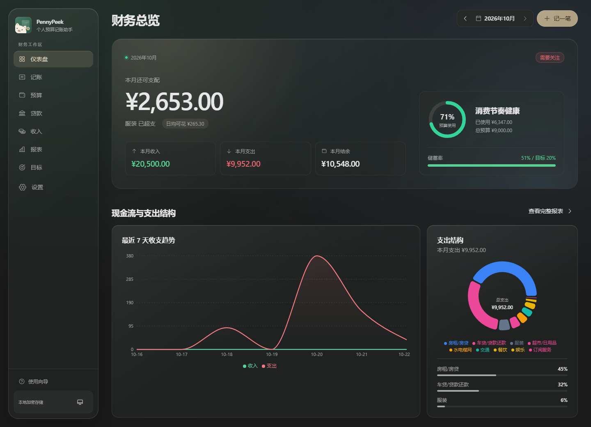
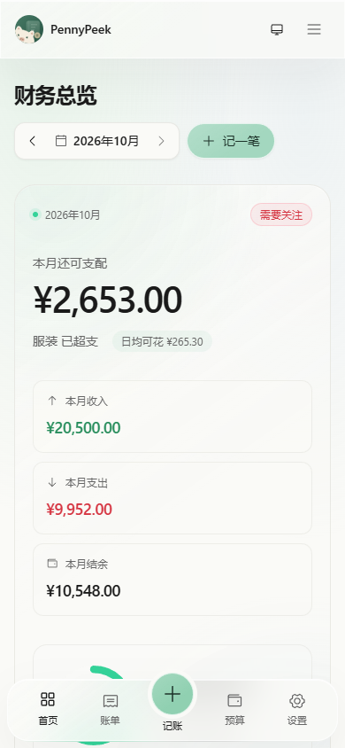

<div align="center">


# PennyPeek · 个人预算账本

**把钱花明白，才能存住钱。**

记录收支、安排预算、管理贷款，让每一个 Penny 都值得 Peek。

[](LICENSE)


**[🌐 立即使用](https://pennypeek.abohack.com/app)** · [产品主页](https://pennypeek.abohack.com/) · [Telegram 群组](https://t.me/+nsrOxDXQMeNkODBh) · [问题反馈](https://github.com/skywalker23241/pennypeek-abohack/issues)



*文档中的应用截图均使用示例数据。*

</div>

---

PennyPeek 是一个面向日常生活的个人预算与记账工具：记录每天的收支，查看分类预算还剩多少，安排贷款还款，追踪储蓄目标，并通过报表回顾钱花在了哪里。

**无需注册，数据默认保存在当前浏览器。** 账单在本机解析，账本可导出为本地 JSON 备份，也可以手动同步到自己的 WebDAV 服务。日常记账不依赖业务后端；可选的 WebDAV 功能通过站点代理转发请求。

## ✨ 功能一览

### 📊 财务总览

- 按月查看收入、支出、结余、预算剩余、储蓄率和贷款还款情况。
- 分类支出图表、近期收支趋势和最近记账记录，打开账本即可查看。
- 汇总预算预警、贷款到期提醒和财务健康评分，帮助发现需要留意的变化。

### 🧾 日常记账与账单导入



- 记录收入、支出、转账和贷款还款，支持分类、支付方式、备注及是否计入预算等信息。
- 按类型、分类、日期筛选，搜索备注与分类，按金额或日期排序。
- 桌面端使用表格，移动端使用卡片和适合触控的表单。
- 导入支付宝 CSV、微信 CSV 或 Excel（`.xlsx`），预览后选择记录、调整分类，再追加到账本。

账单文件仅在本机解析，支持 UTF-8、GBK / GB18030 文本，单次上限为 **10 MB、20,000 行**。应用会按平台交易单号去重；缺少单号时，按时间、金额与交易内容去重。

退款相关、未完成以及充值提现等中性资金往来会跳过，并显示原因。退款不会自动冲销已导入的支出；手工记录与跨平台重复交易需要自行核对。账单导入要求账本使用 CNY，不自动换汇。

### 💰 分类预算



- 按月设置分类预算，查看已用金额、剩余额度和使用进度。
- 分类接近预警线或超支时给出状态提示。
- 支持新增分类预算，以及一键复制上月预算。
- 总预算与记账、总览、报表联动，记录支出后即可查看变化。

### 🏦 贷款与收入管理

- 管理贷款余额、月还款额、还款日、已还期数与还款进度。
- 记录还款后更新贷款状态，并生成对应的记账记录。
- 管理工资、副业等收入来源，一键记录到账。
- 查看近期收入趋势和本月收入来源分布。

贷款还款中的本金与利息按等额本息近似拆分，适合个人记录与回顾；实际金额请以贷款机构账单为准。

### 📈 报表与储蓄目标



- 月度收支汇总、分类支出排行、支出占比与衣食住行分析。
- 按日、周、月回看消费趋势，比较近期月份的收支变化。
- 提示大额支出、分类支出突增、储蓄率偏低等情况。
- 为储蓄目标记录进度，查看剩余金额、预计完成时间和建议投入。

### 🌙 外观与操作体验



- 浅色、深色和跟随系统三种主题设置。
- 响应式布局，适配电脑与手机浏览器。
- 首页支持 `Ctrl / ⌘ K` 打开命令中心，快速进入常用功能。
- 删除、导入覆盖、清空及同步覆盖等操作提供确认步骤。

<div align="center">

</div>

### ☁️ 本地备份与 WebDAV 同步

- **JSON 完整备份**：导出账本数据，或导入备份恢复；恢复前需要确认覆盖。
- **CSV 导出**：导出记账记录，便于在表格工具中查看；完整恢复请使用 JSON。
- **WebDAV**：连接坚果云、NAS、Nextcloud 等自己的服务，手动上传、下载或比较更新时间后同步。
- WebDAV 地址和凭据保存在当前浏览器，不写入账本 JSON 或云端账本快照。

## 🚀 快速开始

| 方式 | 适合场景 | 使用方法 |
| --- | --- | --- |
| **在线版** | 直接记账与管理预算 | 打开 [pennypeek.abohack.com/app](https://pennypeek.abohack.com/app) |
| **产品主页** | 先了解功能与隐私 | 打开 [pennypeek.abohack.com](https://pennypeek.abohack.com/) |
| **本地运行** | 开发、调试或自己部署 | 克隆仓库，安装依赖后运行 Vite |

首次打开会载入示例数据，方便了解预算、贷款和报表的使用方式。开始记录自己的账本前，可在「设置」中清空示例数据；需要体验时也可重新载入。

### 本地开发

建议使用 Node.js 22 和 npm。

```bash
git clone https://github.com/skywalker23241/pennypeek-abohack.git
cd pennypeek-abohack
npm ci
npm run dev
```

开发服务器默认地址为 `http://localhost:5173`，端口被占用时以终端输出为准。`/` 是产品介绍页，`/app` 是账本应用。本地开发服务器已内置 WebDAV 代理。

### 构建与检查

```bash
npm run typecheck        # TypeScript 类型检查
npm run test:bill-import # 账单解析、去重、编码和存储回滚测试
npm run build            # 构建到 dist/
npm run preview          # 本地预览构建产物
```

开发服务器下还可打开 `/tests/billImport.browser.html`，使用虚构数据检查浏览器内 CSV / XLSX 解析。`npm run preview` 仅用于预览构建产物，不提供开发服务器中的 WebDAV 代理。

## 🛠 部署自己的实例

### Netlify

仓库中的 [netlify.toml](netlify.toml) 已配置构建、单页路由和 WebDAV Function：

1. 在 Netlify 导入本仓库。
2. Build command 使用 `npm run build`，Publish directory 使用 `dist`，Functions directory 使用 `netlify/functions`。
3. 部署后打开 `/app`；如需云端备份，在「设置 → WebDAV 云同步」中填写服务地址、用户名、应用密码和文件路径，再测试连接。

可通过环境变量限制代理允许连接的 WebDAV 主机：

```text
WEBDAV_ALLOWED_HOSTS=dav.jianguoyun.com,dav.example.com
```

填写逗号分隔的域名，不包含协议和路径。当前实现未配置此变量时不限制主机；公开部署建议按实际使用的服务设置允许列表。

### 其他托管环境

将 `dist/` 作为静态站点发布，并为 `/app` 等前端路由设置回退到 `index.html`。日常记账与本地备份可以独立使用；如需 WebDAV，还要提供同源 `/api/webdav` 接口，可参考 [Netlify Function](netlify/functions/webdav.mjs)。只上传静态文件不会自动具备 WebDAV 转发能力。

## 🔒 数据、隐私与 Cookie

账本数据默认保存在当前设备、当前浏览器的 `localStorage` 中，不会自动上传到项目维护者的账本服务器。外观偏好、WebDAV 配置和同步状态也存储在本机浏览器。

- **本地备份**：JSON 和 CSV 导出文件保存到你选择的位置，请自行妥善保管。
- **自选 WebDAV**：测试连接或执行手动同步时，账号、密码及同步传输的数据会经过本站同源代理，备份文件保存在你指定的 WebDAV 服务。代理代码不持久保存这些内容；建议使用 HTTPS 和专用应用密码。
- **Cookie 与统计**：应用不使用 Cookie 保存账本，未集成广告 Cookie、行为追踪或第三方统计脚本。托管与安全服务可能使用必要的 Cookie 或保留访问日志。
- **数据删除**：清空本机账本或清除 WebDAV 配置，不会删除已经导出的文件或 WebDAV 上的副本；这些文件需要在对应位置自行管理。

**请定期备份。** 清除网站数据、更换设备或浏览器、结束无痕会话，都可能导致本机记录不可用。浏览器本地存储不等于加密保险箱；备份文件也未做应用层加密，共用设备时请注意访问权限。

## 🧱 技术栈与项目结构

React 18、TypeScript、Vite 5、Tailwind CSS 3、Zustand、React Router、Recharts，以及 Radix UI / Phosphor Icons 等界面组件。

```text
.
├── public/                 # 品牌图标与站点静态文件
├── src/
│   ├── pages/              # 产品首页、总览、记账、预算、贷款、收入、报表、目标、设置
│   ├── components/         # 通用界面、表单、图表和图标
│   ├── lib/                # 财务计算、提醒、账单解析与 WebDAV 同步
│   ├── store/useStore.ts   # 账本状态与本地持久化
│   ├── types/              # 数据类型
│   ├── App.tsx             # 路由与全局 Provider
│   └── index.css           # 主题与全局样式
├── tests/                  # 账单导入、分类、图标与浏览器交互检查
├── netlify/functions/      # WebDAV 同源代理
├── netlify.toml            # Netlify 发布与路由配置
├── vite.config.ts          # 开发代理、路径别名与构建配置
└── package.json            # 依赖与运行命令
```

## 🤝 交流与贡献

欢迎通过 [Telegram 群组](https://t.me/+nsrOxDXQMeNkODBh) 交流使用体验，或提交 [Issue](https://github.com/skywalker23241/pennypeek-abohack/issues) 和 Pull Request。

反馈问题时请附上复现步骤、浏览器与设备信息。涉及账单或备份文件时，请先移除真实姓名、交易单号、账号及 WebDAV 凭据，尽量使用虚构数据复现。

也可以看看 [休历 · RestCal](https://github.com/skywalker23241/restcal-abohack)，安排好休息，再安排好日常的每一笔。

## 📄 许可

本项目使用 [MIT License](LICENSE)。
